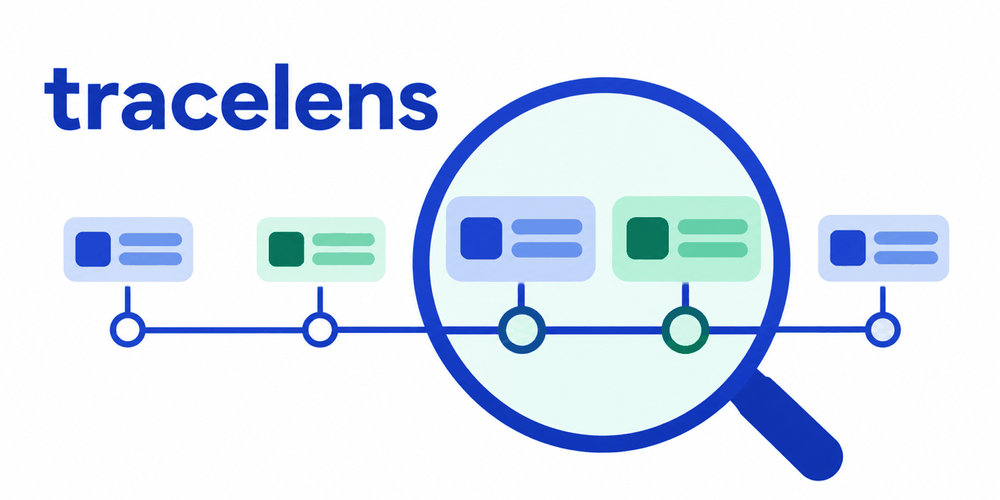
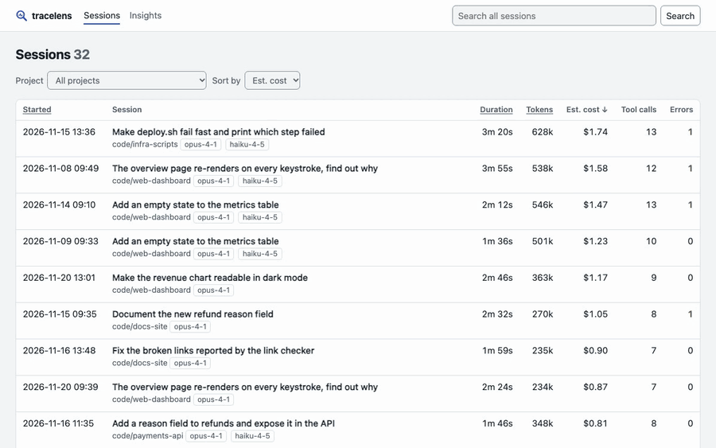
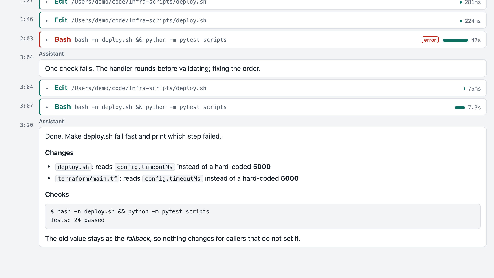
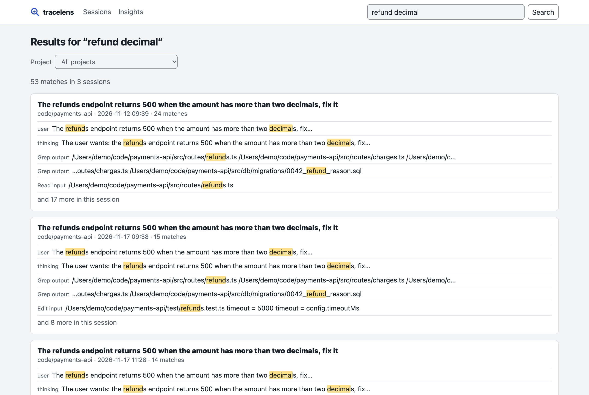

# tracelens

**Read, search and add up your Claude Code and Codex CLI sessions in a local web page.**

tracelens turns the JSONL logs these agents already write into a session list, a full-text search, readable transcripts with every tool call, and a page of token and cost estimates. It runs on your machine, binds to 127.0.0.1, only reads the log files, sends nothing anywhere, and has no runtime dependencies.



## Quickstart

Needs Node.js 22 or newer.

```sh
git clone https://github.com/Habibeyilmazz/tracelens.git
cd tracelens
npm install
npm run build
node dist/src/cli.js serve
```

This reads Claude Code transcripts from `~/.claude/projects` (or `$CLAUDE_CONFIG_DIR/projects`) and Codex CLI sessions from `~/.codex/sessions` and `~/.codex/archived_sessions` (or the same under `$CODEX_HOME`), and opens <http://127.0.0.1:4180/>. A folder that does not exist is skipped.

No logs on this machine, or want to look first? `npm run demo` generates 25 made-up Claude Code sessions and 7 made-up Codex sessions into `.demo/` and serves those instead.

## Features

- **Claude Code and Codex CLI** sessions side by side in one list, one search and one set of insights. Codex sessions carry a "Codex" tag.
- **Session list**: project, start time, duration, models, token totals, estimated cost, tool calls and errors. Filter by project, sort by date, duration, tokens or cost.
- **Full-text search** across every prompt, reply, tool input and tool output, including subagents. Type the words you remember: a session is found when it contains all of them, in any order and in any message (in the demo data, `refund decimal` finds the sessions about a refunds endpoint that fails on amounts with more than two decimals). Put `"quotes"` around an exact phrase. Case is ignored. Each word is highlighted, results can be narrowed to one project, and each hit links to the exact spot in the transcript.
- **Transcript view**: user turns, assistant replies rendered as Markdown (headings, lists, tables, code blocks; links only for http(s), images never loaded), collapsible thinking, tool calls collapsed to one line (tool, main argument, duration bar) that expand to full input and output (on the page, a text block over 40,000 characters is cut with a note saying how much is left; exports keep everything). Subagent runs are nested under the Task call that started them. Failed tool calls and API errors are marked in red, and the header links to the first error.
- **Live sessions**: open a session that is still running (any session with activity in the last hour) and it follows the log as the agent works: new messages and tool calls, subagent steps and updated token totals appear within about 2 seconds, tool calls you opened stay open, and if you are at the bottom the page follows the end. It polls only while the tab is visible.
- **Insights**: tokens and estimated cost per day, per project and per model; most-used tools with error counts and timings; the slowest tool calls; the files edited most often. Filter by time range and project.
- **Export** a session as Markdown or as a single self-contained HTML file, from the CLI or the session page, optionally with paths and secrets redacted.
- **Codex transcripts**: prompts, replies (Markdown), reasoning summaries, and tool calls (`shell`, `apply_patch`, MCP tools, …) paired with their output, timed, and marked red when a command exits non-zero. The environment and `AGENTS.md` text Codex adds to each session is collapsed under "Context added by Codex".
- **Defensive parsing**: records it does not recognise, and lines that are not valid JSON, are shown raw in the transcript instead of breaking the page.
- Light and dark themes (follows your system), keyboard-friendly (scrollable tables and code blocks take focus), AA text contrast, no sideways scrolling down to 320px, and a card layout for the session list on phone-sized screens. No JavaScript frameworks and no runtime dependencies.







## Command line

After the quickstart there is no `tracelens` command yet: run these as `node dist/src/cli.js <command>` from the repo folder, or run `npm link` there once to get `tracelens` on your PATH (it creates a global symlink; `npm unlink -g tracelens` removes it). tracelens is not on npm, and the npm package named `tracelens` is an unrelated project, so do not use `npx tracelens`.

```text
tracelens serve [--port 4180] [--no-open]   Open the web UI on 127.0.0.1
tracelens list [--limit 20]                 Print recent sessions and their ids
tracelens export <session> [options]        Write a transcript as Markdown or HTML

  <session>             A session id, a unique id prefix, or a path to a .jsonl file
                        (a Claude Code transcript or a Codex rollout-*.jsonl)
  -f, --format md|html  Output format (default: from --output extension, else md)
  -o, --output <file>   Write to a file instead of stdout
  --redact              Replace home/project paths, emails and common secret patterns
  --dir <path>          Claude Code projects folder (default ~/.claude/projects)
  --codex-dir <path>    Codex CLI sessions folder (default ~/.codex/sessions);
                        archived_sessions next to a folder named "sessions" is read too
  --pricing <file>      Pricing table for cost estimates
```

Examples:

```sh
node dist/src/cli.js list
node dist/src/cli.js export 3f2a --redact -o session.md
node dist/src/cli.js export ~/.claude/projects/-Users-me-app/3f2a….jsonl -o session.html
node dist/src/cli.js export ~/.codex/sessions/2026/11/20/rollout-2026-11-20T09-12-03-7c1e….jsonl -o codex.md
```

## Compared with other tools

Other tools cover parts of this, and some are a better fit (as of November 2026; check their own READMEs, they change quickly):

- **[ccusage](https://github.com/ryoppippi/ccusage)** prints daily, monthly, per-session and billing-window token and cost reports in the terminal, for Claude Code, Codex and several other agents, with JSON output. Use it if you want numbers in a terminal or a script and do not need to read transcripts. tracelens shows the transcripts and search; ccusage covers more agents and billing windows.
- **[claude-code-log](https://github.com/daaain/claude-code-log)** is a Python tool that turns Claude Code transcripts into HTML or Markdown, with a terminal UI and a search server of its own. Use it if you prefer Python or a terminal browser. tracelens adds cost estimates, insights across sessions, redacted exports and full Codex sessions in the same list.
- **Claude Code's own commands**: `claude --resume` reopens a past session to keep working in it. For usage numbers across a team, Claude Code can [export metrics and events over OpenTelemetry](https://code.claude.com/docs/en/monitoring-usage) to a collector you run. tracelens is for one person looking back at their own logs, with no setup and no collector.
- **LLM tracing platforms** (Langfuse, LangSmith and similar) record traces of apps you build and instrument yourself, usually on a server. tracelens reads the logs your coding agent already writes; it does not instrument anything.

## Cost estimates

Token counts come straight from the logs. Cost is an **estimate**: tokens multiplied by the list prices in [`pricing.json`](pricing.json), in USD per million tokens, with separate rates for input, output, 5-minute and 1-hour cache writes and cache reads. A model id is priced by the longest key it contains, so `claude-sonnet-4-5` also prices `claude-sonnet-4-5-20250929`, but a newer version never borrows an older one's price: `claude-opus-4` does not price `claude-opus-4-9` (add a row for it). Models without a price are counted in tokens and listed as "not priced". Some models cost more per token for very long prompts: Claude Haiku 5.5 above 100,000 tokens, and OpenAI's gpt-5.4 and later above 272K. A model row can carry a `longContext` block with those rates and its threshold (`above`); a request whose prompt (input plus cache writes and cache reads) is over it is priced entirely at the higher rates, as both providers bill it. Claude Code logs usage per request, so this is exact there. Codex logs a running total, so tracelens decides the tier from the size of the last request in each step (`last_token_usage`); in the rare step that covers several requests, all of them get that request's tier.

OpenAI models (used by Codex) are in the same file: `input` is the uncached input rate, `cacheRead` the cached-input rate, and the cache-write rates are 0 because OpenAI does not charge for them. Codex logs count cached tokens inside the input total and reasoning tokens inside the output total; tracelens splits the cached part out and prices reasoning as output, as OpenAI bills it. A version suffix never borrows another version's price: `gpt-5` prices `gpt-5-codex` but not `gpt-5.2`, and a variant without its own row (such as `gpt-5.1-codex-max`) is priced as its base model (`gpt-5.1`), so add a row if its price differs.

Edit `pricing.json` to match your rates, or pass your own file with `--pricing`. If you use a subscription plan you are not billed per token, so treat the number as a measure of usage, not a bill.

## Redaction

`--redact` (on by default in the web UI's export form) rewrites every string in the exported session:

- the session's project folder becomes `<project>`, and home folders (`/Users/<name>`, `/home/<name>`, `C:\Users\<name>`) become `~`;
- emails become `[email]`;
- common secret shapes become `[REDACTED]`: Anthropic, OpenAI, GitHub, GitLab, Slack, AWS, Google, npm, Stripe, Hugging Face and SendGrid keys, Slack and Discord webhook URLs, JWTs, bearer tokens, private key blocks, passwords in URLs, and `api_key=` / `token:` / `password=` style assignments;
- a string too long to check (an unbroken run of several million characters, such as a base64url blob) is replaced whole by a `[REDACTED: … characters too long to check for secrets]` note.

It is pattern matching, so read an export before you share it.

## How it works

- **Discovery.** Claude Code keeps one JSONL file per session in `~/.claude/projects/<encoded-folder>/<session-id>.jsonl`. Subagent logs live either inline (records with `isSidechain: true`), in `<session-id>/subagents/*.jsonl`, or in `agent-*.jsonl` files next to the sessions. tracelens handles all three. Codex CLI writes one `rollout-<time>-<session-id>.jsonl` per session under `~/.codex/sessions/YYYY/MM/DD/`, and moves archived ones to `~/.codex/archived_sessions/`; tracelens reads both.
- **Parsing** ([`src/claude.ts`](src/claude.ts)) turns records into a small normalized model ([`src/types.ts`](src/types.ts)): user and assistant messages, thinking, tool calls paired with their results, system events, and raw items for anything else. Claude Code writes one line per content block and repeats the message's usage on each, so usage is counted once per API message id. Claude Code's own bookkeeping is kept out of the way: `file-history-snapshot` records (checkpoint backups) and `progress` records (hook, shell and subagent progress ticks, whose end result is recorded elsewhere) are skipped, `<synthetic>` messages it writes locally add no usage, post-compaction summaries are shown as system notes rather than user turns, and files that hold nothing but summary lines are not listed as sessions. A tool call's duration is the time between the call and its result. A subagent is attached to the Task call whose `prompt` matches the subagent's first message (in start order, so repeated identical prompts pair up correctly); subagents that match nothing are listed at the end of the transcript. Odd input is shown, not fatal: a line that is not JSON, or is nested more than 200 levels deep, appears as an "Unreadable line" (except a last line with no newline yet, which the agent is still writing: it shows up once complete); a timestamp before 2000 or more than a day in the future is ignored; a byte-order mark is skipped; session files over 512 MB (up to 2 GB, the most Node reads at once) are split into lines from the bytes.
- **Codex parsing** ([`src/codex.ts`](src/codex.ts)) reads `{timestamp, type, payload}` lines into the same model. The transcript comes from `response_item` lines (messages, reasoning summaries, `function_call`/`custom_tool_call` paired with their `*_call_output` by `call_id`); the `event_msg` copies of the same prompts, replies and commands are skipped. A tool call failed when its output starts with a non-zero `Exit code:` / `Process exited with code`, when older JSON-wrapped output has a non-zero `metadata.exit_code`, or when the output says `success: false`. Token usage comes from `token_count` events: their `total_token_usage` is cumulative and often repeated, so each event counts only the growth since the previous one. The model is the one from the latest `turn_context`. Files from before the envelope format (a bare metadata line, then bare response items) are read too. Codex has no subagent logs to nest.
- **Serving** ([`src/server.ts`](src/server.ts)) uses Node's `http` module and renders HTML on the server. Parsed sessions are cached and a file is re-read only when its size or modification time changes, so new sessions show up on reload. A live session page asks for itself again every 2 seconds with `If-None-Match`; the server answers `304 Not Modified` until one of the session's files changes size or modification time, and only then renders it, and `app.js` swaps the new header and transcript into the page.
- **Read-only.** Log files are opened for reading only. `export -o` refuses to write inside either log folder or to any `.jsonl` file.
- **Local only.** The server listens on 127.0.0.1, answers only requests addressed to `127.0.0.1`, `localhost` or `[::1]` on its own port (which blocks DNS-rebinding pages), only accepts GET and HEAD, and sends a strict Content-Security-Policy. Other websites (and other servers on 127.0.0.1) can link to a tracelens page, but the browser's Fetch Metadata headers let tracelens refuse their attempts to load pages as images, scripts, frames or fetches, so they cannot time searches over your transcripts. All transcript text is HTML-escaped. The page loads no fonts, scripts or images from the internet, and an exported HTML file carries its own Content-Security-Policy. A Markdown export keeps messages as Markdown but cannot load anything when it is viewed (on GitHub, in an editor preview): outside code, HTML is escaped and image syntax is kept as text, and code blocks get a fence their content cannot close. Inline code that holds `<` is written as an HTML `<code>` element, which a viewer without HTML support shows as a tag.
- **No login.** There is no password or token: any program running on your machine, under any user account, can read the web UI while `tracelens serve` runs. On a shared machine, stop it when you are done.
- **Session URLs** are `/session/<folder>/<session id>`, because the same session id can appear in more than one Claude Code project folder. For a Codex session the folder is the day folder (`/session/20/<id>`), or `archived_sessions` for an archived one.

Both log formats are internal to their tools and change between versions. tracelens was written against synthetic fixtures modelled on the documented layout and field names (Claude Code: `type`, `message`, `usage`, `isSidechain`, `toolUseResult`, …; Codex: `session_meta`, `turn_context`, `response_item`, `event_msg`, `token_count`, …, taken from published schema notes), not against captured real logs, so expect to see some events shown raw; they are never dropped.

### Adding another log format

The UI, search, insights and exporters only read the `Session` type in [`src/types.ts`](src/types.ts). An adapter is a module with a `discover(dir)` that lists session files and a `parse(files)` that returns a `Session`, plus one line in [`src/store.ts`](src/store.ts). [`src/codex.ts`](src/codex.ts) is a small example.

## Development

```sh
npm install
npm test               # build, then run the node:test suite against synthetic fixtures (~2 s)
npm run test:e2e       # Playwright: the main journey in Chromium against `tracelens serve` (needs `npx playwright install chromium` once)
TRACELENS_SLOW_TESTS=1 npm test   # also reads a 600 MB session file (writes it to the temp folder)
npm run typecheck
npm run demo           # synthetic data on http://127.0.0.1:4180
node scripts/screenshots.mjs http://127.0.0.1:4180   # Playwright check + screenshots (needs `npx playwright install chromium` once)
node scripts/demo-gif.mjs http://127.0.0.1:4180      # re-record docs/demo.gif from the demo (also needs ffmpeg)
```

The test fixtures are hand-made. `test/fixtures/projects` (Claude Code) covers split assistant messages, inline and file-based subagents, an orphan subagent, tool errors, API errors, meta messages, unknown event types and a truncated line. `test/fixtures/codex` covers injected context, duplicate events, plain-text and JSON-wrapped shell output, an `apply_patch` call, a call with no result, repeated `token_count` totals, an error event, unknown event types, a truncated line, and the older pre-envelope layout. [`test/robustness.test.ts`](test/robustness.test.ts) holds the odd-input cases (deep nesting, byte-order marks, out-of-range timestamps, emoji, multi-megabyte runs, junk ids and token counts).

## Roadmap

Ideas, not promises:

- Show rewound or edited conversation branches as a tree instead of file order.
- A search index for very large histories (search is a linear scan over sessions held in memory today).
- Read session files over 2 GB by streaming them (they are skipped with a warning today).
- CSV export of the insights tables.
- Publish as an npm package so it runs without cloning (under another name: `tracelens` on npm belongs to an unrelated package).

## Known limits

- Both log formats are undocumented internals of their tools. tracelens was built from synthetic fixtures and has not yet been checked against a wide range of real logs, so some records may show up as "Unrecognized". They are shown raw, never dropped. If you see one, please [open an issue](https://github.com/Habibeyilmazz/tracelens/issues/new?template=unrecognized-record.yml) with a redacted, made-up copy of the record.
- Everything is parsed into memory: about 1.8 GB of RAM for 1.4 GB of logs in a synthetic test.
- No login on the web UI (see "No login" above).

## Contributing

Bug reports and small pull requests are welcome. See [CONTRIBUTING.md](CONTRIBUTING.md) for the setup and the few rules (no real logs in fixtures, tests for parser changes). Security problems: see [SECURITY.md](SECURITY.md).

## License

[MIT](LICENSE)
