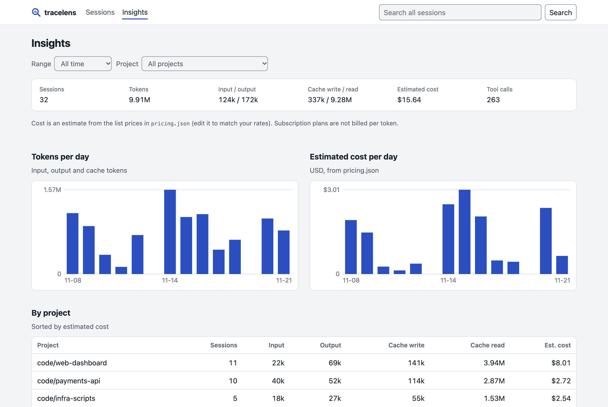

# tracelens

A local viewer and analytics page for Claude Code session logs: browse every session, search them all, read a transcript with its tool calls, and see where your tokens went.
It runs on your machine, binds to 127.0.0.1, only reads the log files, and sends nothing anywhere.


## Quickstart

Needs Node.js 22 or newer.

```sh
git clone https://github.com/Habibeyilmazz/tracelens.git
cd tracelens
npm install
npm run build
node dist/src/cli.js serve
```

This reads `~/.claude/projects` (or `$CLAUDE_CONFIG_DIR/projects`) and opens <http://127.0.0.1:4180/>.

No Claude Code logs on this machine, or want to look first? `npm run demo` generates 25 made-up sessions into `.demo/` and serves those instead.

## Features

- **Session list**: project, start time, duration, models, token totals, estimated cost, tool calls and errors. Filter by project, sort by date, duration, tokens or cost.
- **Full-text search** across every prompt, reply, tool input and tool output, including subagents. Each hit links to the exact spot in the transcript.
- **Transcript view**: user turns, assistant text, collapsible thinking, tool calls collapsed to one line (tool, main argument, duration bar) that expand to full input and output. Subagent runs are nested under the Task call that started them. Failed tool calls and API errors are marked in red, and the header links to the first error.
- **Insights**: tokens and estimated cost per day, per project and per model; most-used tools with error counts and timings; the slowest tool calls; the files edited most often. Filter by time range and project.
- **Export** a session as Markdown or as a single self-contained HTML file, from the CLI or the session page, optionally with paths and secrets redacted.
- **Defensive parsing**: records it does not recognise, and lines that are not valid JSON, are shown raw in the transcript instead of breaking the page.
- Light and dark themes (follows your system), works on a phone-sized screen, no JavaScript frameworks and no runtime dependencies.



## Command line

```text
tracelens serve [--port 4180] [--no-open]   Open the web UI on 127.0.0.1
tracelens list [--limit 20]                 Print recent sessions and their ids
tracelens export <session> [options]        Write a transcript as Markdown or HTML

  <session>             A session id, a unique id prefix, or a path to a .jsonl file
  -f, --format md|html  Output format (default: from --output extension, else md)
  -o, --output <file>   Write to a file instead of stdout
  --redact              Replace home/project paths, emails and common secret patterns
  --dir <path>          Claude Code projects folder
  --pricing <file>      Pricing table for cost estimates
```

Examples:

```sh
node dist/src/cli.js list
node dist/src/cli.js export 3f2a --redact -o session.md
node dist/src/cli.js export ~/.claude/projects/-Users-me-app/3f2a….jsonl -o session.html
```

To get a `tracelens` command on your PATH, run `npm link` in the repo (it creates a global symlink; `npm unlink -g tracelens` removes it).

## Cost estimates

Token counts come straight from the logs. Cost is an **estimate**: tokens multiplied by the list prices in [`pricing.json`](pricing.json), in USD per million tokens, with separate rates for input, output, 5-minute and 1-hour cache writes and cache reads. A model id is priced by the longest key it contains, so `claude-sonnet-4-5` also prices `claude-sonnet-4-5-20250929`. Models without a price are counted in tokens and listed as "not priced".

Edit `pricing.json` to match your rates, or pass your own file with `--pricing`. If you use a subscription plan you are not billed per token, so treat the number as a measure of usage, not a bill.

## Redaction

`--redact` (on by default in the web UI's export form) rewrites every string in the exported session:

- the session's project folder becomes `<project>`, and home folders (`/Users/<name>`, `/home/<name>`, `C:\Users\<name>`) become `~`;
- emails become `[email]`;
- common secret shapes become `[REDACTED]`: Anthropic, OpenAI, GitHub, Slack, AWS, Google and npm keys, JWTs, bearer tokens, private key blocks, passwords in URLs, and `api_key=` / `token:` / `password=` style assignments.

It is pattern matching, so read an export before you share it.

## How it works

- **Discovery.** Claude Code keeps one JSONL file per session in `~/.claude/projects/<encoded-folder>/<session-id>.jsonl`. Subagent logs live either inline (records with `isSidechain: true`), in `<session-id>/subagents/*.jsonl`, or in `agent-*.jsonl` files next to the sessions. tracelens handles all three.
- **Parsing** ([`src/claude.ts`](src/claude.ts)) turns records into a small normalized model ([`src/types.ts`](src/types.ts)): user and assistant messages, thinking, tool calls paired with their results, system events, and raw items for anything else. Claude Code writes one line per content block and repeats the message's usage on each, so usage is counted once per API message id. Claude Code's own bookkeeping is kept out of the way: `file-history-snapshot` records (checkpoint backups) are skipped, `<synthetic>` messages it writes locally add no usage, post-compaction summaries are shown as system notes rather than user turns, and files that hold nothing but summary lines are not listed as sessions. A tool call's duration is the time between the call and its result. A subagent is attached to the Task call whose `prompt` matches the subagent's first message; subagents that match nothing are listed at the end of the transcript.
- **Serving** ([`src/server.ts`](src/server.ts)) uses Node's `http` module and renders HTML on the server. Parsed sessions are cached and a file is re-read only when its size or modification time changes, so new sessions show up on reload.
- **Read-only.** Log files are opened for reading only. `export -o` refuses to write inside the log folder.
- **Local only.** The server listens on 127.0.0.1, answers only requests addressed to `127.0.0.1`, `localhost` or `[::1]` on its own port (which blocks DNS-rebinding pages), only accepts GET, and sends a strict Content-Security-Policy. All transcript text is HTML-escaped. The page loads no fonts, scripts or images from the internet.

The Claude Code log format is internal to Claude Code and changes between versions. tracelens was written against synthetic fixtures modelled on the documented layout and field names (`type`, `message`, `usage`, `isSidechain`, `toolUseResult`, …), not against a captured real log, so expect to see some events shown raw; they are never dropped.

### Adding another log format

The UI, search, insights and exporters only read the `Session` type in [`src/types.ts`](src/types.ts). A Codex CLI adapter would be a module that finds Codex session files and returns `Session` objects, plus a line in [`src/store.ts`](src/store.ts) to include them. It is on the roadmap.

## Development

```sh
npm install
npm test               # build, then run the node:test suite against synthetic fixtures
npm run typecheck
npm run demo           # synthetic data on http://127.0.0.1:4180
node scripts/screenshots.mjs http://127.0.0.1:4180   # Playwright check + screenshots (needs `npx playwright install chromium` once)
```

The test fixtures in `test/fixtures/projects` are hand-made and cover split assistant messages, inline and file-based subagents, an orphan subagent, tool errors, API errors, meta messages, unknown event types and a truncated line.

## Roadmap

- Codex CLI adapter.
- Render Markdown in assistant messages (shown as plain text today).
- Show rewound or edited conversation branches as a tree instead of file order.
- A search index for very large histories (search is a linear scan today).
- CSV export of the insights tables.
- Publish as an npm package so `npx tracelens serve` works without cloning.

## License

[MIT](LICENSE)
